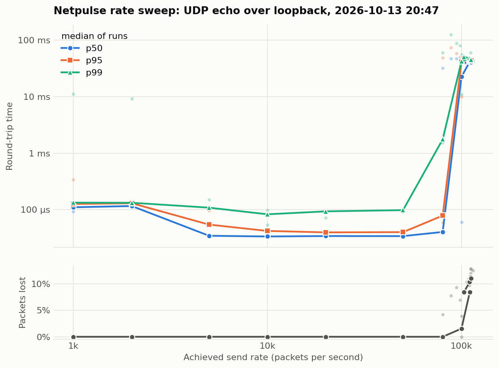

# Netpulse

A UDP latency load tester: it pushes a network path with a controlled, rising
stream of packets and measures exactly how and when the path starts to degrade.

## Results


Sweep of 2026-10-15, UDP over loopback on an Apple M1 laptop. Each value is the
median of five 2 second runs.

| Send rate (pps) | p50 | p99 | Packets lost |
|---|---|---|---|
| 10,000 | 41 µs | 66 µs | 0% |
| 50,000 | 34 µs | 304 µs | 0% |
| 80,000 | 37 µs | 1.7 ms | 0% |
| 100,000 | 49 µs | 4.7 ms | 0% |
| 110,000 | 39.5 ms | 42.3 ms | 5.4% |

- **The tail breaks first.** Between 50,000 and 100,000 pps, p99 grows about
  15 times while p50 barely moves. An average would have hidden this.
- **Then the path collapses.** Between 100,000 and 110,000 pps, p50 jumps about
  800 times, from 49 µs to 40 ms, and packets start being dropped.
- **The bottleneck is the echo server's receive queue.** Packet counts on both
  sides show every lost packet disappears before the server reads it.
- **Jitter stays flat (4 to 11 µs) even at saturation**, because a full queue
  delays every packet by about the same amount. Percentiles and loss reveal the
  knee; jitter does not.

Full write-up with every rate, the rules behind each finding, and the
limitations: [results/2026-10-15-1601/report.md](results/2026-10-15-1601/report.md).

## What it does

Netpulse sends UDP packets to an echo server at a configurable rate, times the
round trip of every single packet, and steps the send rate up until the path
saturates. Rather than averaging, it records *every* round-trip time, so it can
report tail latency, the behaviour that actually matters under load.

## Why

Every network path has a breaking point. Under light traffic it's fast and
lossless; as traffic rises, internal queues fill until latency spikes and packets
drop. That transition is sudden, not gradual. Netpulse is a controlled experiment
to find that point. It's the same question capacity planning and load testing ask of
real systems.

## What it measures

- **Latency percentiles (p50 / p95 / p99)**: the median and, critically, the tail.
- **Jitter**: variation in inter-packet delay (RFC 3550).
- **Loss rate**: the fraction of packets that never return.
- **The knee** : the load level where p99 and loss turn sharply upward while p50
  still looks fine.

## Architecture

The hot path is C++; the orchestration around it is Python.

- **C++ core**: the send/receive loop, per-packet timestamping, RTT storage, and
  percentile math. C++ is used here for *measurement fidelity*: at thousands of
  packets per second, an interpreted runtime's pauses would be recorded as network
  latency. A tight, predictable C++ loop keeps the numbers honest.
- **Python orchestration**: runs the C++ core at each rate in the sweep, collects
  the results, and produces the plots and summary. It is not timing-sensitive,
  so Python's convenience costs nothing.

The load generator is **open-loop**: it sends at a fixed rate regardless of what
comes back, which is what lets queues build and the knee appears.

## Roadmap

- [x] **Phase 0** : UDP echo round-trip in C++ (proves a packet can make the trip)
- [x] **Phase 1**: per-packet RTT timing
- [x] **Phase 2**: load loop + p50 / p95 / p99 at a single rate
- [x] **Phase 3**: rate sweep (1,000 to 200,000 pps) + Python plots
- [x] **Phase 4**: jitter, loss, and the results writeup

## Build & run

Build with CMake (install it with `brew install cmake` ):

```bash
cmake -S . -B build
cmake --build build
```

This puts `./echo_server` and `./client` in the project folder, built with
optimisation on. Without CMake, the same can be done directly:

```bash
g++ -std=c++17 -O2 src/echo_server.cpp -o echo_server
g++ -std=c++17 -O2 -pthread src/client.cpp -o client
```

Then run them in two terminals:

```bash
./echo_server        # terminal 1 — stays running, waiting for packets
./client 1000 5      # terminal 2 — 1000 packets per second for 5 seconds
```

The client takes the send rate (packets per second) and the duration (seconds),
and defaults to `1000 5`. It prints the rate it actually achieved, the loss, and
the p50 / p95 / p99 round-trip times:

```
target rate: 1000 pps   achieved: 1000 pps
sent: 5000   received: 5000   lost: 0 (0.00%)
including warm-up: sent 5100, received 5100, failed sends 0
p50: 116.5 us   p95: 132.1 us   p99: 145.8 us   (5000 samples, after 100 warm-up packets)
jitter: 9.4 us (RFC 3550)   mean change: 8.2 us   longest loss burst: 0 packets
```

Add `--csv` at the end (`./client 1000 5 --csv`) to get the same result as one
comma-separated line, which is what `sweep.py` reads.

The echo server prints nothing while packets are flowing, because printing
would slow it down and be measured as latency. Once it has been idle for half a
second it prints a summary of the run that just ended:

```
run summary: received 5100, echoed 5100, failed to echo 0
```

### Rate sweep

With the echo server running, `sweep.py` runs the client at 17 rates from 1,000
to 200,000 pps, five times each for 2 seconds, and takes about 5 minutes:

```bash
python3 sweep.py                # run the sweep, then plot it and write the report
python3 sweep.py --redraw       # redo the plot and report of the latest sweep
```

Every sweep gets its own folder in `results/`, named after the date and time it
started, so earlier sweeps are never overwritten:

```
results/2026-10-15-1601/
    sweep.csv    one row per run
    sweep.png    the plot
    report.md    the written findings
    meta.json    when, where and how the sweep was run
```

`--redraw` works on the latest sweep, or on the folder you name after it. It
needs matplotlib (`pip3 install matplotlib`). The rates, duration and repeat
count are constants at the top of the script.

The sweep was first planned as 100 → 5000 pps, but loopback on this machine does
not start to degrade until around 80,000 pps, so that range would have shown a
flat line.

## How it was built, phase by phase


Phase 0, UDP echo verified end to end:


Phase 1, per-packet RTT timing:


Measurement fidelity, printing vs no printing in the echo server:


The server used to print a line for every packet it echoed. That print sits
inside the timed round trip, so the client was measuring terminal output as if
it were network latency: about 10 µs per packet at the median, roughly a third
of the whole RTT on loopback. The echo loop now prints nothing. Ranges are
across three runs of 500 packets each, with the first 20 dropped as warm-up.

Phase 2, load loop + p50 / p95 / p99 at a single rate:


Warm-up handling changed: the warm-up packets used to be taken out of the run,
so `./client 1000 5` reported only 4900 samples. They are now sent in addition,
before the measured packets and at the same rate, so the run reports the full
`rate × duration` samples (5000 here).


Phase 3, rate sweep from 1,000 to 200,000 pps over loopback:



The knee is between 80,000 and 100,000 pps. Each point is the median of three
2 second runs, with the individual runs shown as faint dots.

- **Up to 50,000 pps** the path is healthy: no loss, p50 settles near 34 µs and
  p99 stays around 100 µs.
- **At 80,000 pps** the tail moves first: p99 is about 1.8 ms while p50 is
  still 40 µs. The path is already unstable here: two of the three runs lost
  nothing, but the third saturated, with 4% loss and a p50 of 32 ms.
- **At 100,000 pps** the path is saturated in two of the three runs: the median
  p50 is about 22 ms and 1.5% of packets are lost. The one run that held on
  kept a p50 of 60 µs, but its p99 was 11 ms.
- **Past that** every run is saturated: p50 sits at about 41 ms, more than 1000
  times slower than the healthy 34 µs, and 8 to 11% of packets are lost.

The sender cannot push more than about 110,000 pps on this machine, so every
target from 120,000 up lands at roughly the same achieved rate. That is why the
plot's x axis is the achieved rate, not the target. RTT is also higher at 1,000
to 2,000 pps (about 110 µs) than at 5,000: at low rates both programs sleep
between packets, and the wake-up time is part of what gets measured.

Phase 4, jitter, loss, and the results writeup:


The full written report for this sweep is in
[results/2026-10-15-1601/report.md](results/2026-10-15-1601/report.md).

#### What we added and why

**1. Jitter.** Percentiles tell you how slow packets were, but not in what order.
Imagine two runs with the same eight round trips:

```
Run A:  30  30  30  30  300 300 300 300   µs   one slow patch
Run B:  30  300 30  300 30  300 30  300   µs   flapping every packet
```

Both have exactly the same p50 and p99, yet Run B is far worse for something
like a voice call, because the delay keeps jumping around. Jitter measures that
jumping. For every pair of packets sent one after the other, the client takes
the difference between their round trips, `D = |RTT[i] - RTT[i-1]|`, and
reports it two ways:

- **Mean change**: the average of every `D` in the run. This is the one on the
  plot, because it describes the whole run.
- **RFC 3550 jitter**: the formula from the standard used for voice and video
  over the internet (RTP). It keeps a running value `J = J + (D - J) / 16`, so
  each packet nudges it only a little, and its final value mostly reflects the
  end of the run.

The RFC measures one way delay, but our client only knows when a packet left
and when it came back, so both numbers are round trip jitter.

**2. Loss bursts.** Losing 1,000 packets spread out and losing 1,000 in one gap
are very different. Every packet has its own slot by sequence number, so the
client can count the longest run of consecutive packets that never came back.

**3. Where packets get lost.** In Phase 3 we saw loss but did not know where it
happened: the client and server each have a receive queue, and either could
overflow. To find out, the echo server now counts what it receives and echoes,
and prints a summary when a run ends. The client prints its own totals
including warm-up. At 150,000 pps (a run on 2026-10-15):

| Step | Packets |
|---|---|
| Client sent | 300,100 |
| Server received | 273,573 |
| Server echoed | 273,573 |
| Client received | 273,573 |

So every lost packet disappeared before the server could read it, and none
after. **The bottleneck is the echo server**: it reads one packet, sends it
back, then reads the next, and at about 100,000 pps it cannot keep up. Its
receive queue fills, the kernel drops whatever does not fit, and every packet
that does fit waits behind a full queue, which is where the 40 ms comes from.

**4. A dated report for every sweep.** `sweep.py` now writes each sweep into
its own folder named after the date and time, with the data, the plot, a record
of the machine and code version, and a written report. The report's findings
are computed from the data with fixed rules that the report states (for
example, "a run is saturated when it loses packets or its p50 is more than 10
times the best p50"), so a new sweep always gets a report that matches its own
numbers, and old reports stay as they were.

**5. A more careful sweep.** Phase 3 showed that near the knee, runs at the
same rate disagree. So the sweep now runs each rate five times instead of three,
tests more rates between 60,000 and 110,000 pps, and drops most of the rates
above the sender's limit, which all landed on the same point.

#### What we found (sweep of 2026-10-15)

- **Healthy up to about 50,000 pps**: no loss, p50 around 33 µs, p99 under 100 µs.
- **The tail goes first.** At 60,000 pps p99 is already near 1 ms, and from
  80,000 pps it is in the milliseconds, while p50 stays between 33 and 50 µs
  all the way to 100,000 pps.
- **The knee is between 100,000 and 105,000 pps**, but it is a range rather
  than a point: at 85,000 and 95,000 pps one run in five already saturated.
- **Once saturated**, p50 jumps to about 40 ms, about 1,200 times the healthy
  value, and 5 to 9% of packets are lost. The losses are many short gaps of
  8 to 13 packets, not one long outage.
- **Jitter does not reveal the knee.** It stays between about 4 and 11 µs at
  every rate, even when the round trip is 1,200 times slower. A full queue
  delays every packet by about the same amount, so the delay is huge but steady.
  That is why load testing looks at percentiles and loss, not just jitter.
- **The sender tops out near 110,000 pps**, just above the knee, so this setup
  can push the server past its limit, but not far past it.

These numbers come from one MacBook (Apple M1, on battery) over loopback, with
client and server sharing the same CPU. They will differ on another machine or
another day; the report's Limitations section covers this.
