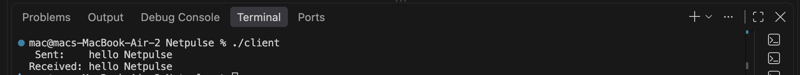
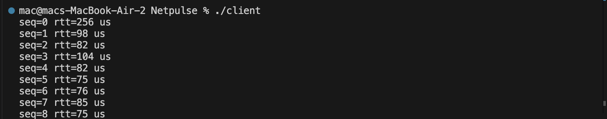
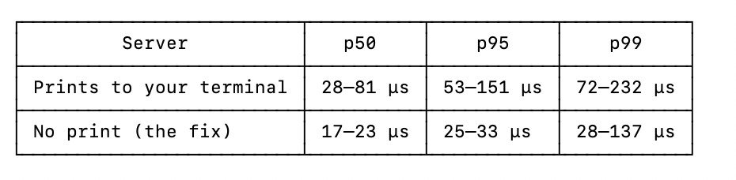
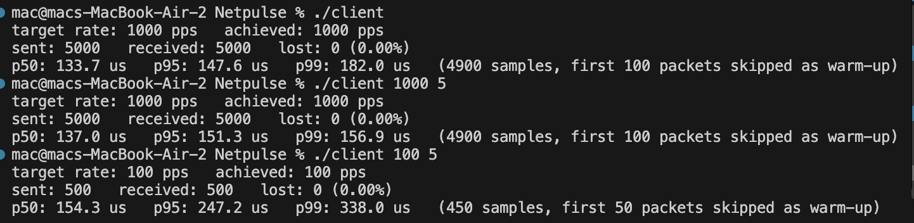
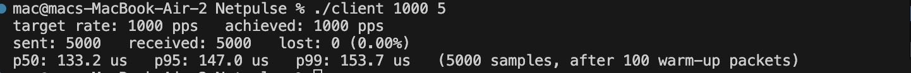
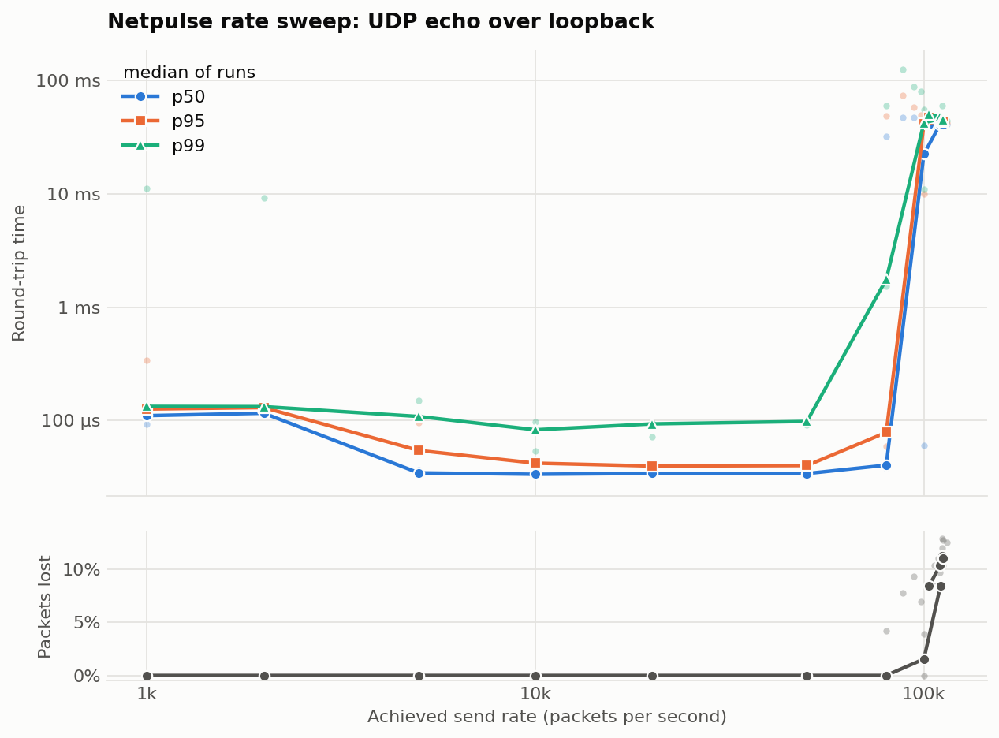

# Netpulse

A UDP latency load tester: it pushes a network path with a controlled, rising
stream of packets and measures exactly how and when the path starts to degrade.

## What it does

Netpulse sends UDP packets to an echo server at a configurable rate, times the
round trip of every single packet, and steps the send rate up until the path
saturates. Rather than averaging, it records *every* round-trip time, so it can
report tail latency, the behaviour that actually matters under load.

## Why

Every network path has a breaking point. Under light traffic it's fast and
lossless; as traffic rises, internal queues fill until latency spikes and packets
drop. That transition is sudden, not gradual. Netpulse is a controlled experiment
to find that point. I's the same question capacity planning and load testing ask of
real systems.

## What it measures

- **Latency percentiles (p50 / p95 / p99)**: the median and, critically, the tail.
- **Jitter**: variation in inter-packet delay (RFC 3550).
- **Loss rate**: the fraction of packets that never return.
- **The knee** : the load level where p99 and loss turn sharply upward while p50
  still looks fine.

## Architecture

The hot path is C++; the orchestration around it is Python.

- **C++ core**: the send/receive loop, per-packet timestamping, RTT storage, and
  percentile math. C++ is used here for *measurement fidelity*: at thousands of
  packets per second, an interpreted runtime's pauses would be recorded as network
  latency. A tight, predictable C++ loop keeps the numbers honest.
- **Python orchestration**: runs the C++ core at each rate in the sweep, collects
  the results, and produces the plots and summary. It is not timing-sensitive,
  so Python's convenience costs nothing.

The load generator is **open-loop**: it sends at a fixed rate regardless of what
comes back, which is what lets queues build and the knee appears.

## Roadmap

- [x] **Phase 0** : UDP echo round-trip in C++ (proves a packet can make the trip)
- [x] **Phase 1**: per-packet RTT timing
- [x] **Phase 2**: load loop + p50 / p95 / p99 at a single rate
- [x] **Phase 3**: rate sweep (1,000 to 200,000 pps) + Python plots
- [ ] **Phase 4** : jitter, loss, and the results writeup

## Build & run

```bash
g++ -std=c++17 -O2 src/echo_server.cpp -o echo_server
g++ -std=c++17 -O2 -pthread src/client.cpp -o client

./echo_server        # terminal 1 — stays running, waiting for packets
./client 1000 5      # terminal 2 — 1000 packets per second for 5 seconds
```

The client takes the send rate (packets per second) and the duration (seconds),
and defaults to `1000 5`. It prints the rate it actually achieved, the loss, and
the p50 / p95 / p99 round-trip times:

```
target rate: 1000 pps   achieved: 1000 pps
sent: 5000   received: 5000   lost: 0 (0.00%)
p50: 135.2 us   p95: 146.2 us   p99: 155.4 us   (5000 samples, after 100 warm-up packets)
```

### Rate sweep

With the echo server running, `sweep.py` runs the client at 13 rates from 1,000
to 200,000 pps, three times each for 2 seconds, and takes about 3 minutes:

```bash
python3 sweep.py                # run the sweep, then plot it
python3 sweep.py --plot-only    # redraw the plot from the saved CSV
```

It writes one row per run to `results/sweep.csv` and the plot to
`results/sweep.png`. It needs matplotlib (`pip3 install matplotlib`). The rates,
duration and repeat count are constants at the top of the script.

The sweep was first planned as 100 → 5000 pps, but loopback on this machine does
not start to degrade until around 80,000 pps, so that range would have shown a
flat line.

## Status


Phase 0, UDP echo verified end to end:




Phase 1, per-packet RTT timing:



Measurement fidelity, printing vs no printing in the echo server:



The server used to print a line for every packet it echoed. That print sits
inside the timed round trip, so the client was measuring terminal output as if
it were network latency: about 10 µs per packet at the median, roughly a third
of the whole RTT on loopback. The echo loop now prints nothing. Ranges are
across three runs of 500 packets each, with the first 20 dropped as warm-up.

Phase 2, load loop + p50 / p95 / p99 at a single rate:



Warm-up handling changed: the warm-up packets used to be taken out of the run,
so `./client 1000 5` reported only 4900 samples. They are now sent in addition,
before the measured packets and at the same rate, so the run reports the full
`rate × duration` samples (5000 here).



Phase 3, rate sweep from 1,000 to 200,000 pps over loopback:



The knee is at about 100,000 pps. Each point is the median of three 2-second
runs, with the individual runs shown as faint dots.

- **Up to 50,000 pps** the path is healthy: no loss, and p50 settles near 35 µs.
- **At 80,000 pps** the tail moves first: p99 is about 1.2 ms while p50 is
  still 37 µs.
- **At 100,000 pps** p95 is about 2.3 ms and p99 about 5 ms, still with no loss
  and a p50 of 42 µs.
- **Past that** the path is saturated: p50 jumps to about 40 ms, roughly 1000
  times slower, and about 10% of packets are lost.

The sender cannot push more than about 114,000 pps on this machine, so every
target from 120,000 up lands at the same achieved rate. That is why the plot's
x-axis is the achieved rate, not the target. RTT is also higher at 1,000 to
2,000 pps than at 5,000: at low rates both programs sleep between packets, and
the wake-up time is part of what gets measured.
