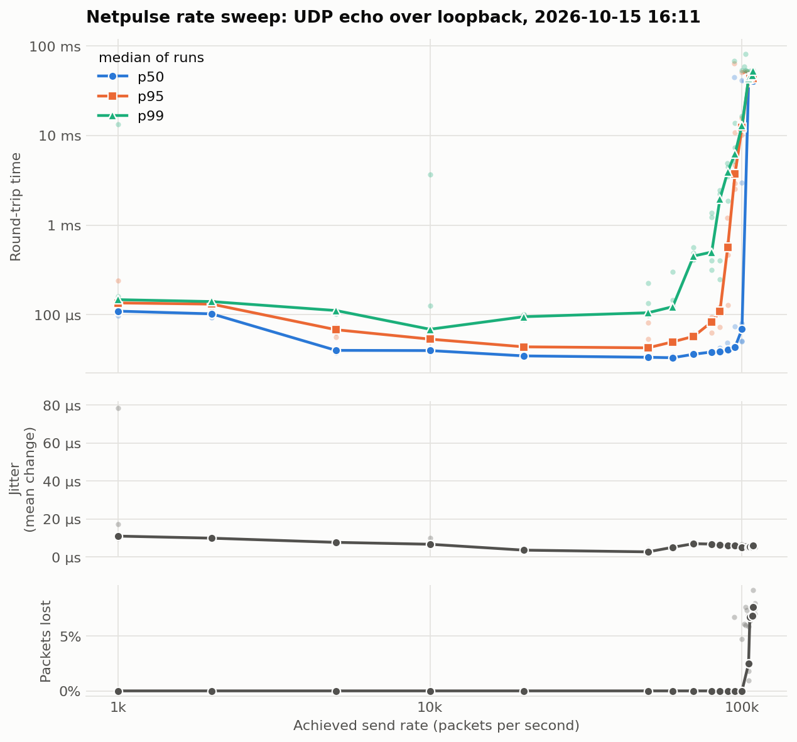

# Netpulse sweep report, 2026-10-15 16:11

## Setup

- **Date**: 2026-10-15 16:11
- **Path**: UDP over loopback (127.0.0.1), client and echo server on the same machine
- **Machine**: Apple M1, 8 cores, macOS 26.6.1, on battery
- **Code version**: 8f21473 plus uncommitted changes
- **Rates**: 17 targets from 1,000 to 200,000 pps
- **Runs**: 5 per rate, 2 seconds each, 1 second pause between runs

## Findings

- **The knee is between 100,000 and 105,000 pps.** Below it the path keeps up; from 105,000 pps it is saturated.
- **Healthy up to 80,000 pps**: no loss, best p50 of 33 µs and best p99 of 69 µs.
- **The tail degrades first.** At 85,000 pps p99 is already 2.0 ms while p50 is still 39 µs and the median run loses nothing.
- **Once saturated**, p50 is 39.1 ms to 40.3 ms, about 1,200 times the best p50, and 2.5% to 7.6% of packets are lost. Where packets are lost, the longest loss burst per run is 10 to 13 packets in a row, against at least 5,211 lost per run, so the losses are many short gaps rather than one long one.
- **Unstable rates**: 100,000 (1 of 5 runs saturated). At these rates the path tips into saturation in some runs and not others, so the knee is a range, not a point.
- **The sender tops out near 110,000 pps.** From 120,000 pps up it cannot reach the target, so those rates land on roughly the same point of the plot.
- **Jitter** (mean change between consecutive round trips) ranges from 2.7 µs at 50,000 pps to 11 µs at 1,000 pps.
- **Jitter barely moves at saturation**: 5.5 µs against 6.8 µs when healthy, while p50 grows about 1,200 times. A full queue delays every packet by about the same amount, so the delay is huge but steady. Jitter alone would not reveal the knee.



## Results by rate

Each row is the median of that rate's runs. ⚠ marks an unstable rate, where some runs lost packets and others did not. Every individual run is in `sweep.csv`.

| Target pps | Achieved pps | Loss | p50 | p95 | p99 | Jitter (mean) | Jitter (RFC 3550) | Longest loss burst |
|---|---|---|---|---|---|---|---|---|
| 1,000 | 1,000 | 0.00% | 110 µs | 135 µs | 147 µs | 11 µs | 11 µs | 0 |
| 2,000 | 2,000 | 0.00% | 102 µs | 131 µs | 140 µs | 9.9 µs | 4.8 µs | 0 |
| 5,000 | 5,000 | 0.00% | 40 µs | 68 µs | 111 µs | 7.7 µs | 8.7 µs | 0 |
| 10,000 | 10,000 | 0.00% | 40 µs | 53 µs | 69 µs | 6.7 µs | 4.7 µs | 0 |
| 20,000 | 20,000 | 0.00% | 35 µs | 44 µs | 95 µs | 3.6 µs | 4.6 µs | 0 |
| 50,000 | 50,006 | 0.00% | 34 µs | 43 µs | 105 µs | 2.7 µs | 1.4 µs | 0 |
| 60,000 | 60,017 | 0.00% | 33 µs | 50 µs | 123 µs | 5.1 µs | 4.9 µs | 0 |
| 70,000 | 70,032 | 0.00% | 36 µs | 57 µs | 452 µs | 7.0 µs | 6.1 µs | 0 |
| 80,000 | 80,037 | 0.00% | 38 µs | 83 µs | 500 µs | 6.8 µs | 7.0 µs | 0 |
| 85,000 | 85,044 | 0.00% | 39 µs | 108 µs | 2.0 ms | 6.5 µs | 6.9 µs | 0 |
| 90,000 | 90,049 | 0.00% | 41 µs | 563 µs | 3.9 ms | 6.2 µs | 5.3 µs | 0 |
| 95,000 | 95,058 | 0.00% | 43 µs | 3.7 ms | 6.3 ms | 5.9 µs | 6.0 µs | 0 |
| 100,000 ⚠ | 100,060 | 0.00% | 69 µs | 12.2 ms | 12.9 ms | 5.2 µs | 5.7 µs | 0 |
| 105,000 | 105,073 | 2.48% | 39.1 ms | 42.3 ms | 43.4 ms | 5.0 µs | 3.6 µs | 10 |
| 110,000 | 106,064 | 6.73% | 40.1 ms | 43.2 ms | 45.6 ms | 5.5 µs | 4.8 µs | 10 |
| 120,000 | 108,216 | 6.85% | 40.3 ms | 44.8 ms | 47.2 ms | 5.5 µs | 4.0 µs | 10 |
| 200,000 | 108,715 | 7.63% | 40.3 ms | 43.2 ms | 52.4 ms | 5.9 µs | 4.4 µs | 13 |

## How to read this

- **p50, p95, p99**: sort every round-trip time (RTT) in a run. p50 is the middle one, so half the packets were faster. p99 is the one 99% of packets beat, so it shows the slowest 1%, the tail.
- **Jitter** is how much the delay changes from one packet to the next. Percentiles cannot show this, because they ignore the order packets arrived in. *Jitter (mean)* averages the change between every pair of consecutive packets over the whole run. *Jitter (RFC 3550)* is the running estimate from the RTP standard, which moves 1/16 of the way towards each new change, so it mostly reflects the end of the run. Both use round trips rather than one-way delays, because the client only knows when a packet left and came back.
- **Longest loss burst** is the most packets lost in a row. 1,000 losses spread out and 1,000 in one gap are very different for an application.
- **The rules behind the findings**: the tail has degraded when p99 is more than 10 times its best value in the sweep. A run is saturated when it loses packets or its p50 is more than 10 times the best p50 in the sweep, and a rate is saturated when its median run is. A rate is unstable when some of its runs are saturated and others are not. The sender has fallen short when it achieves less than 95% of the target rate.

## Limitations

- **Loopback, not a real network.** No cable, no router: the bottleneck is how fast this machine moves packets between two programs.
- **Client and server share one machine**, so they compete for the same CPU. A heavy client can slow the server it is measuring.
- **Results vary between runs and between days**, depending on what else the machine is doing and whether it is on battery. Compare reports from the same machine and conditions.
- **Low rates read slower than mid rates.** Between packets both programs go to sleep, and waking up is part of the measured time.

## Reproduce

```bash
./echo_server        # terminal 1
python3 sweep.py     # terminal 2
```
